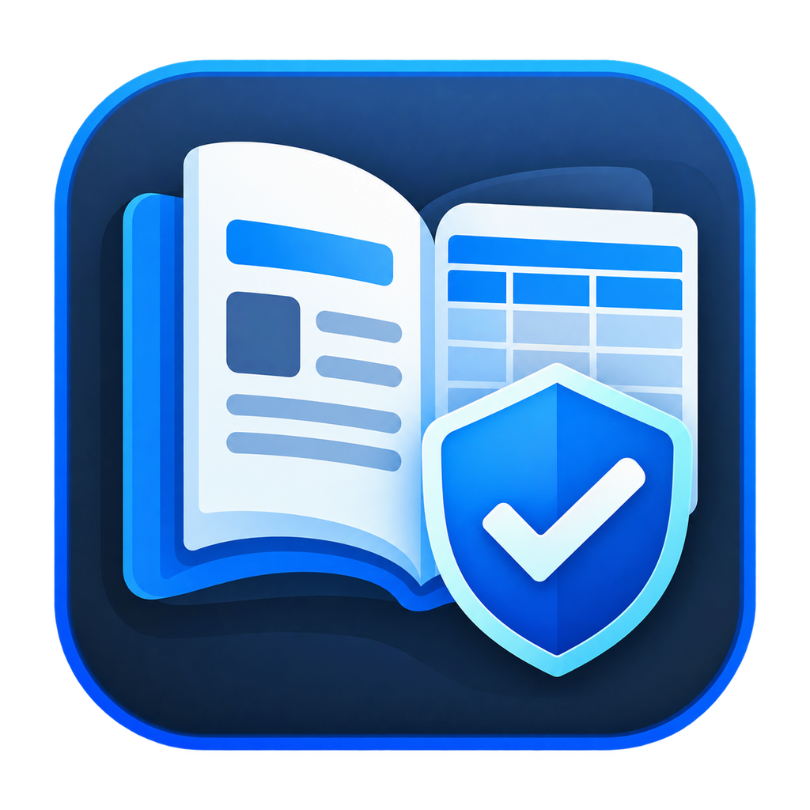

<div align="center">
  
  <h1>ИРБИС64 Контроль</h1>
  <p>Приложение для Windows: сверка библиотечных записей ИРБИС64 с перечнями, подготовка Excel-отчётов и контролируемое добавление служебных меток.</p>
  <p>
    <a href="https://github.com/VseMirka200/irbis64-control/releases/latest"></a>&nbsp;
    <a href="docs/USER_GUIDE.md"></a>&nbsp;
    <a href="https://github.com/VseMirka200/irbis64-control/issues/new"></a>
  </p>
</div>

**«ИРБИС64 Контроль»** помогает библиотекарям проверять записи ИРБИС64 по специальным перечням и реестрам. Программа сопоставляет ISBN, название, автора, издательство и год, предлагает ручную проверку неоднозначных совпадений и сохраняет результаты в Excel. Служебные метки в базе добавляются только после подтверждения пользователя.

> **Важно:** программа помогает подготовить и проверить результаты, но не заменяет решения ответственного сотрудника. Перед массовыми изменениями проверьте выборку и создайте резервную копию базы.

## Возможности

- Работа с сервером ИРБИС64 или TXT-выгрузкой библиотечной базы.
- Загрузка актуальных перечней с сайта НКП РГБ либо использование локальных Excel-таблиц.
- Сопоставление записей по нескольким библиографическим признакам.
- Ручная проверка спорных совпадений с сохранением решений для следующих запусков.
- Выгрузка Excel-отчётов, сравнение отчётов и TXT-баз.
- Добавление и удаление поддерживаемых служебных меток с предварительным просмотром.
- Для TXT — создание новой копии без перезаписи исходного файла.
- Для сервера — повторная проверка записей перед изменением и создание резервных данных для восстановления.
- Журнал операций и отдельные настройки источников, правил поиска, отчётов и меток.

## Установка на Windows

Скачайте файлы со страницы [последнего релиза](https://github.com/VseMirka200/irbis64-control/releases/latest).

| Вариант | Файл | Для чего |
| --- | --- | --- |
| Установщик | `IRBIS64Control-Installer-vX.Y.Z-Windows-x64.exe` | Обычная установка для 64-разрядной Windows |
| Портативная версия | `IRBIS64Control-windows-x64.zip` | Запуск без установки; распакуйте архив целиком |
| Контрольные суммы | `SHA256SUMS.txt` | Проверка целостности загруженных файлов |

В портативной версии храните оба EXE рядом. Не скачивайте установщик из неофициальных источников. Наличие SHA-256 подтверждает совпадение файла с опубликованной суммой, **но само по себе не подтверждает личность издателя**.

Текущая версия исходного кода указана в `pyproject.toml` и `irbis_control/__init__.py`.

## Быстрый старт

1. Откройте раздел **Данные** и выберите сервер ИРБИС64 либо TXT-выгрузку.
2. Используйте автоматические перечни НКП РГБ или добавьте свои Excel-файлы.
3. В разделе **Параметры** выберите режим: отчёт, метки или оба результата.
4. Для первой проверки рекомендуем режим **Только Excel-отчёт**.
5. Нажмите **Запустить проверку**, затем проверьте неоднозначные совпадения вручную.
6. Просмотрите результаты на странице **Результат**. Перед отправкой меток в рабочую базу проверьте план изменений и наличие резервной копии.

Пошаговые инструкции, настройки, память решений и обслуживание базы: [Руководство пользователя](docs/USER_GUIDE.md).

## Безопасная работа с данными

- Начинайте с небольшой тестовой выборки, особенно перед записью на сервер.
- Используйте отдельную учётную запись ИРБИС64 с минимальными необходимыми правами.
- Не публикуйте в Issues реальные библиотечные базы, учётные данные, закрытые адреса серверов, журналы с персональными данными или необезличенные отчёты.
- При работе с TXT исходный файл не перезаписывается: результат сохраняется отдельно.
- При работе с сервером приложение повторно проверяет запись перед записью, чтобы не перезаписать изменения другого пользователя.
- Программа хранит локальные параметры подключения, включая пароль, **без дополнительного шифрования**. Защищайте учётную запись Windows и каталог настроек.

Подробности и порядок конфиденциального сообщения об уязвимости: [Политика безопасности](.github/SECURITY.md).

## Разработка и проверки

Проект написан на **Python 3.11+**, интерфейс использует **PyQt6**. Для запуска из исходного кода:

```powershell
git clone https://github.com/VseMirka200/irbis64-control.git
cd irbis64-control
py -3.11 -m venv .venv
.\.venv\Scripts\python.exe -m pip install -r requirements.txt
.\.venv\Scripts\python.exe main.py
```

Для проверки изменений дополнительно установите `ruff>=0.6,<1` и выполните:

```powershell
.\.venv\Scripts\python.exe -m pip install "ruff>=0.6,<1"
.\.venv\Scripts\python.exe -m ruff check .
.\.venv\Scripts\python.exe -m ruff format --check .
.\.venv\Scripts\python.exe scripts\run_tests.py
```

В GitHub Actions действуют тесты для Python 3.11 и 3.13, анализ CodeQL и проверка изменений зависимостей. Основная ветка `main` и релизные теги защищены Rulesets; автоматическое слияние Dependabot отключено. Новые релизы создаются по тегам `vX.Y.Z` из коммитов `main`.

Подробности для участников: [Правила участия](docs/CONTRIBUTING.md) и [Архитектура](docs/ARCHITECTURE.md).

## Помощь, контакты и документы

- **Ошибки и предложения:** [GitHub Issues](https://github.com/VseMirka200/irbis64-control/issues/new).
- **Общие вопросы и обратная связь:** [vsemirka200@bk.ru](mailto:vsemirka200@bk.ru).
- **Потенциальные уязвимости:** [приватное сообщение GitHub Security Advisory](https://github.com/VseMirka200/irbis64-control/security/advisories/new) либо резервный контакт по [политике безопасности](.github/SECURITY.md). Не раскрывайте подробности в публичных Issues.
- **Правила сообщества:** [Кодекс поведения](.github/CODE_OF_CONDUCT.md).
- **Лицензия:** [MIT](LICENSE).
